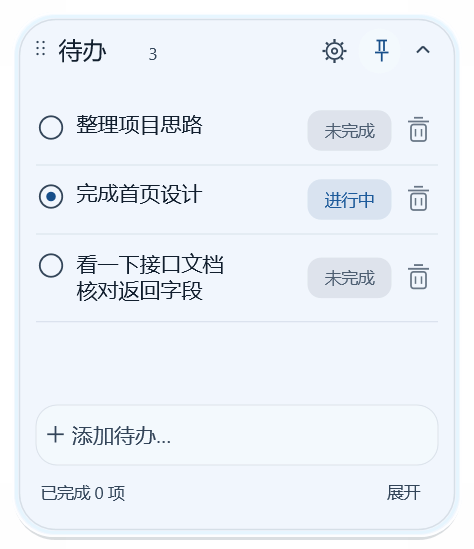
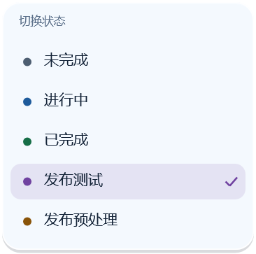

# 玻璃待办 · GlassTodo

[English](README.en.md) · [下载 Windows 版](https://github.com/jevin98/glass-todo/releases) · [使用指南](docs/usage.md) · [开发指南](docs/development.md) · [MCP 文档](docs/mcp.md)

[](https://github.com/jevin98/glass-todo/actions/workflows/ci.yml) [](LICENSE)

一个轻量的 Windows 原生悬浮待办软件。随手记录、拖到屏幕边缘收成图标，也能让 Codex、Claude Code、Cursor 通过 MCP 直接读写待办数据。

Rust + Win32 + Direct2D / DirectWrite + SQLite，内置本机 HTTP MCP 服务。无需 WebView、Electron、Node.js 或模型 API key。

 

预览由应用自身的渲染器和合成数据生成；发布状态名称是自定义示例，首次启动只包含三个内置状态。

## 功能

- 可拖动、置顶和缩放的桌面便签；支持浮条与四方向贴边图标，悬停展开，移出后延迟收回。
- 多行正文、空行分隔批量新增、编辑、排序、软删除与跨重启撤销。
- 未完成、进行中、已完成，以及可定义名称、颜色和归类的自定义状态。
- 统一的外观 / 状态设置：浅色、深色、跟随系统、背景遮挡、字号、圆角；自动保存。
- Windows 原生 Rich Edit 输入，支持中文输入法和长正文滚动。
- 窗口位置、尺寸、贴边方向、待办和配置持久化；支持当前用户登录自启。
- 11 个 MCP 数据工具，与界面共用版本检查和 SQLite 事务，写入成功后通知界面刷新。

## 快速开始

1. 从 [Releases](https://github.com/jevin98/glass-todo/releases) 下载 `GlassTodo-<版本>-windows-x64.zip`。
2. 解压到一个固定目录，运行 `GlassTodo.exe`。默认启用当前用户登录自启，可在右键菜单关闭。
3. 点击底部添加区域新建，双击正文编辑；`Shift+Enter` 换行，`Enter` 保存，`Esc` 取消。
4. 新增多条待办时，条目之间至少留一行空行；普通换行仍属于同一条正文。
5. 点击右上角齿轮打开设置，点击状态标签切换状态。

数据保存在 `%LOCALAPPDATA%\GlassTodo`，与 EXE 分离，替换程序不会清空待办。右键隐藏到托盘会保留 MCP，选择退出则同时停止服务。备份、迁移、快捷键和启动参数见 [使用指南](docs/usage.md)。

**系统范围：** Windows 10 / Windows 11 x64。已在 Windows 10 LTSC 19044、150% DPI 验证。Windows 10 使用底色与边缘高光回退，**没有桌面实时模糊**；Windows 11 的 Acrylic 接口按系统支持程度启用，仍需要实机验证。

## 轻量目标与实测

0.1.12 的 GNU Release EXE 约 **2.91 MB**。同一版本在 Windows 10 上，以 100 条合成待办、一个活跃 MCP session 的隐藏贴边图标路径测得约 **4.61 MiB 私有工作集**，约 5 秒采样的空闲 CPU 为 **0.000%**。

这些是具体测试条件下的样本，不包含打开编辑器、设置和输入法后的额外占用。不同编译目标、系统、字体与使用过程会有差异。目标为 ZIP ≤5 MB、EXE ≤10 MB、代表性场景下空闲私有工作集争取 ≤40 MiB，详见 [验证与复现](docs/verification.md)。

## 接入 agent

首次启动会在 `%LOCALAPPDATA%\GlassTodo\mcp-configs` 生成 Codex、Claude Code、Cursor 的本机连接示例。将所需条目合并到客户端自己的配置，并重新加载 MCP 连接。**这些生成文件含真实访问密钥，不要提交或分享。**

默认地址为 `http://127.0.0.1:57841/mcp`，仅接受本机连接及 Bearer token。所有工具直接读取 / 修改数据，不使用截图或键鼠自动化。

例如对 agent 说：

> 使用 glass_todo MCP 读取待办，查找“检查发布记录”，读取自定义状态列表，将它标记为“发布测试”；保留正文并传入最新 expected_version。

自定义状态的流程是 `list_statuses` → `update_todo(status_id, expected_version)`；`status` 的三个固定值只是兼容归类。完整参数、配置模板、冲突处理及旧工具目录排查见 [MCP 接入与 API](docs/mcp.md)。

## 从源码构建

在安装了 Rust stable、Visual Studio C++ Build Tools 和 Windows SDK 的 **Developer PowerShell** 中运行：

```powershell
git clone https://github.com/jevin98/glass-todo.git
cd glass-todo
cargo test --locked
.\scripts\build.ps1 -UseCurrentToolchain
```

ZIP 和 SHA-256 文件生成在 `dist/`。正常构建使用仓库内的图标，无需 Python；Python 3.11+ 用于 MCP 集成测试、预览导出与资源测量，不是应用运行依赖。GNU 工具链、隔离开发数据和 CI 说明见 [开发指南](docs/development.md)。

## 项目导航

| 文档 | 内容 |
| --- | --- |
| [Usage](docs/usage.md) | 界面、快捷键、备份、迁移、启动参数 |
| [Development](docs/development.md) | MSVC / GNU 构建、测试、打包、预览、CI |
| [Architecture](docs/architecture.md) | 模块职责、线程、数据流、Win32 生命周期 |
| [Data model](docs/data-model.md) | SQLite 结构、状态分类、版本冲突、删除与撤销 |
| [MCP](docs/mcp.md) | 三种客户端配置与 11 项工具契约 |
| [Troubleshooting](docs/troubleshooting.md) | 端口、鉴权、输入法、材质、工具缓存 |
| [Verification](docs/verification.md) | 已验证范围、资源样本、复现命令和限制 |
| [Changelog](CHANGELOG.md) | 版本变更 |
| [Contributing](CONTRIBUTING.md) | 贡献与发布流程 |
| [Security](SECURITY.md) | 本机信任边界与私密报告 |

本项目当前不包含云同步、团队协作、远程访问、自动下载更新或内置 AI 对话。欢迎提交符合轻量原生定位的改进，许可证为 [MIT](LICENSE)。

依赖包及其许可文本见 [第三方说明](third-party/README.md)。
