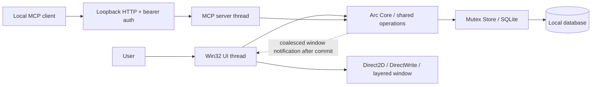

# Architecture

GlassTodo is one native Windows process. The UI and local MCP server share one application core and one SQLite connection. There is no browser renderer, separate daemon, cloud backend or embedded language model.

## Module map

| Module | Responsibility |
| --- | --- |
| `main.rs` | Parse configuration, enforce GUI instance behavior, start/stop MCP and UI |
| `config.rs` | Data path, port, local token, generated client examples and diagnostics |
| `core.rs` | Shared operations, database mutex, appearance preview cache and coalesced UI notifications |
| `store.rs` | Schema migration, transactions, version checks, sorting, deletion/undo and durable settings |
| `statuses.rs` | Status definitions, built-in IDs, custom IDs and colors |
| `mcp.rs` | Eleven data tool schemas, authenticated HTTP transport and tool results |
| `ui.rs` | Main window, input editor, hit regions, tray, docking integration and native lifecycle |
| `render.rs` | Software Direct2D / DirectWrite drawing and layered-window presentation |
| `motion.rs` | Analytic critically damped springs that settle and stop |
| `docking.rs` | Edge detection, icon/expanded geometry and first-entry hover gate |
| `preferences.rs` | One settings host with lazy appearance/status child pages |
| `settings.rs` | Appearance preview, delayed persistence and controls |
| `status_manager.rs` | Version-aware status editing and reassignment on deletion |
| `status_picker.rs` | Colored native popup, keyboard navigation and finite animation |
| `appearance.rs` | Saved theme, opacity, size and radius values |

## Data mutation and notification

Both UI commands and MCP calls invoke `Core`; they do not maintain separate copies of the business rules. A write locks `Store`, performs validation and commits SQLite, releases the mutex, then notifies the window. Returning MCP success means persistence has completed. A minimized or hidden UI is not required for the data operations to succeed.

`WM_REFRESH` notifications are coalesced with an atomic pending flag. The UI re-reads committed records rather than trusting a stale tool response. Appearance preview uses a separate cached value and notification, while durable save goes to SQLite. See [data model](data-model.md).

## Native rendering and input

The main note is a per-pixel-alpha layered window. A software Direct2D DC target paints a 32-bit premultiplied surface; DirectWrite handles text layout and badge alignment. The Windows 11 backdrop is an optional separate input-transparent DWM surface. Unsupported systems use the painted tint/rim fallback; Windows 10 does not receive real desktop blur from this path.

The editor loads system `Msftedit.dll` lazily and creates a plain-text Rich Edit control. It keeps a document-wide insertion format and matching background for IME composition. Placeholder text is painted only for an empty, unfocused, non-composing control. Native vertical scrollbars and explicit wheel routing handle long text without changing its content. This system DLL is not redistributed.

Settings use a single top-level host with child pages. The status form is created on demand and reused to retain unsaved draft text when switching tabs.

## Motion and docking

Springs support continuous reversal without overshoot. Animation timers run only while a spring or geometry transition is active. Docking stores the full note size separately from the 48-DIP icon geometry.

Fresh edge docking requires an intentional icon entry; an old mouse message over the shrinking panel must not reopen it. Hover previews validate leave events after about 320ms. The first leave deadline is retained through data refreshes; canceled or stale timer messages cannot consume a newer deadline. A leave from transparent padding still schedules validation. Settled animations re-arm the appropriate client/nonclient leave tracking. A settled icon does not poll the pointer.

## Win32 lifetime boundaries

Native calls can synchronously re-enter a window procedure. `ui.rs` guards stateful dispatch and defers refreshes around those nested calls. Do not retain a mutable Rust borrow while entering an uncontrolled nested native message loop. Raw userdata pointers must be attached once and detached before freeing their owning box; owned windows, GDI handles, timers and capture require explicit lifetime care.

The tests use private data and non-activating/off-screen native windows. They exercise actual native controls, drawing and message paths, but do not replace a physical IME, multi-monitor or material check on each supported OS.

## Extending the app

Add a business operation to `Store`/`Core` first, then expose the same operation to UI and MCP. Preserve existing tool names and optional-field compatibility. Keep schema migrations transactional and preserve undo references. Changes to timers, dependencies or rendering should include an idle process measurement, not only a Rust heap estimate.
